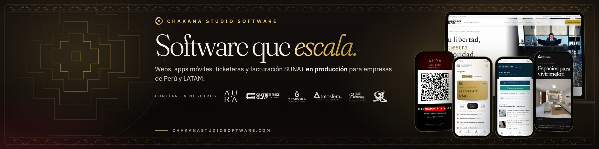
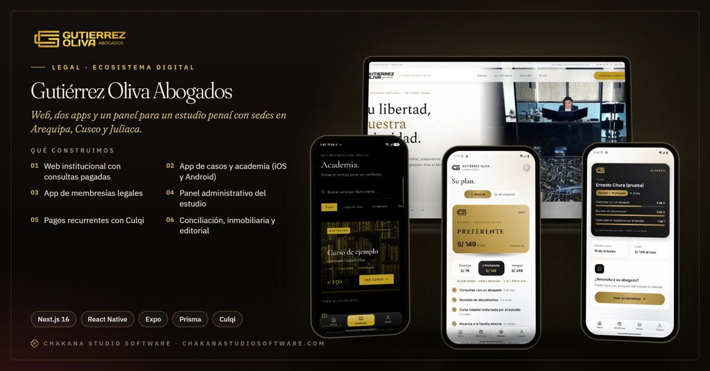
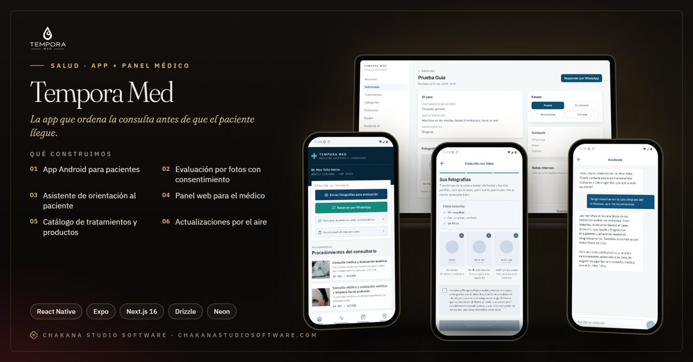
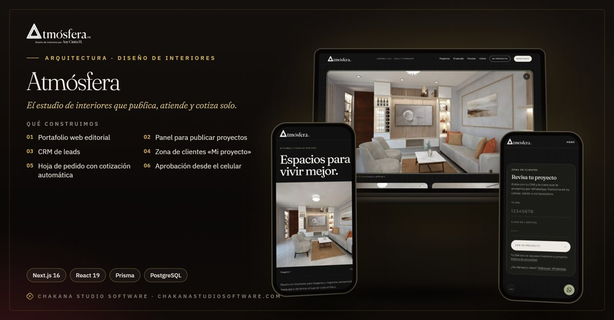
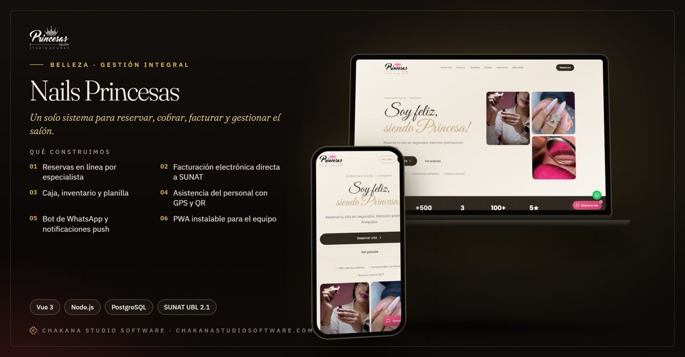
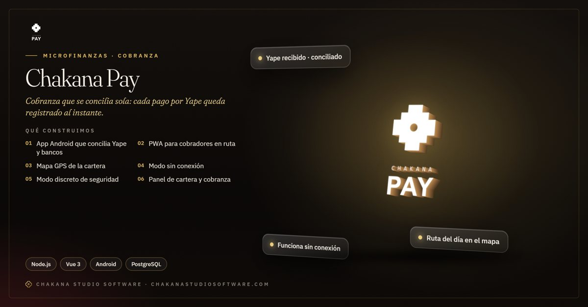

## Jerson Ernesto Chura Pacci

Fundador y CEO de **[Chakana Studio Software](https://www.chakanastudiosoftware.com)**, estudio de desarrollo de software de Arequipa, Perú.

Construyo software que las empresas usan todos los días: plataformas web, apps móviles, paneles de gestión, pagos en línea, facturación electrónica SUNAT y asistentes de WhatsApp. Me encargo de todo el proyecto, de la arquitectura al despliegue y el soporte en producción.

[Sitio web](https://www.chakanastudiosoftware.com) · [LinkedIn](https://www.linkedin.com/in/jersonchura) · [Chakana en LinkedIn](https://www.linkedin.com/company/chakana-studio-software) · [Casos](https://www.chakanastudiosoftware.com/casos)

---

### Sistemas en producción

<table>
<tr>
<td width="50%"> <b>Gutiérrez Oliva Abogados</b> Web, dos apps móviles y panel para un estudio con sedes en Arequipa, Cusco y Juliaca.</td>
<td width="50%"> <b>AURA Tickets</b> Ticketera que vende, cobra en línea y controla la puerta, incluso sin señal.</td>
</tr>
<tr>
<td width="50%"> <b>Tempora Med</b> App médico-estética con evaluación por fotos y panel para el especialista.</td>
<td width="50%"> <b>Atmósfera</b> Web y sistema para un estudio de diseño de interiores, con cotización automática.</td>
</tr>
<tr>
<td width="50%"> <b>Nails Princesas</b> Gestión integral de salón con citas, caja y facturación electrónica SUNAT.</td>
<td width="50%"> <b>Chakana Pay</b> Cobranza con Yape conciliado al instante, sin revisar capturas a mano.</td>
</tr>
</table>

---

### Stack

**Frontend:** Next.js · React · Astro · Vue / Nuxt · TypeScript · Tailwind CSS 
**Móvil:** React Native · Expo 
**Backend:** Node.js · Express · Django · PostgreSQL · Redis · Prisma · Drizzle 
**Integraciones:** SUNAT (facturación electrónica) · Mercado Pago · Izipay · Culqi · Yape · WhatsApp 
**Infraestructura:** Vercel · Railway · Neon · Cloudflare R2 · Docker

---

¿Tienes un proceso que hoy se hace a mano o un sistema que no termina de funcionar? Escríbeme por [LinkedIn](https://www.linkedin.com/in/jersonchura) o desde [chakanastudiosoftware.com](https://www.chakanastudiosoftware.com/contacto).
